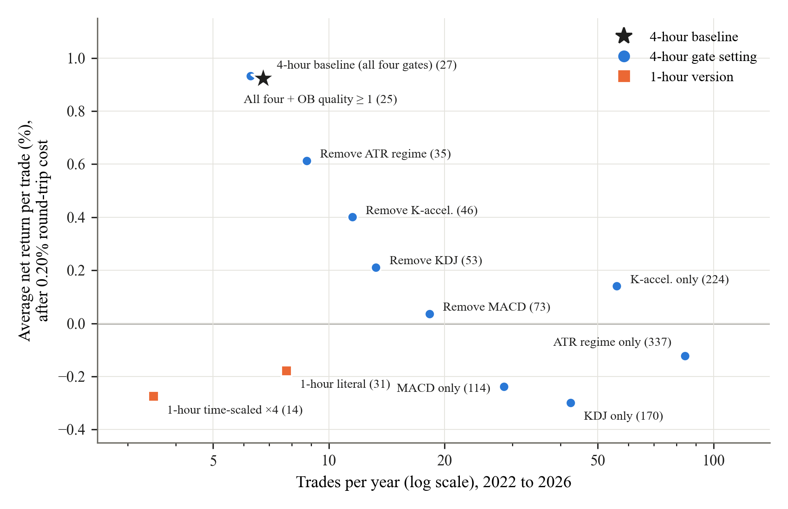

# CIPHER: Can a rule-based Bitcoin strategy beat simply buying every week?

## The question

We wrote one fixed set of trading rules that combines four chart tools: MACD,
KDJ, ATR and Order Blocks. We set every rule using 2018–2021 charts and then
froze them. We then tested the rules on four years of Bitcoin prices they had
never been tuned on, January 2022 to January 2026. We asked three things:

1. Does it win more often than a coin flip?
2. How does it compare with buying a fixed amount of Bitcoin every week?
3. Can it trade more often without earning less per trade?

## Four key numbers

| | |
|---|---|
| **27 trades, 70.37% won** | Before trading costs: +30.31% in total, p = 0.0261. |
| **p = 0.1239 after costs** | With a realistic 0.20% cost per trade, two small winners become losers, and the win rate is no longer statistically significant. |
| **$13,418 vs $22,313** | Final value of $10,000 placed in the strategy, compared with $10,000 bought weekly. Weekly buying won by a wide margin. |
| **Sharpe 0.558 → 0.632** | Moving 30% of a weekly buying plan into the strategy made the plan smoother. Maximum drawdown improved from −27.85% to −23.18%. |

## Trading more often vs. earning per trade

The star marks our rules as written: about 7 trades a year, +0.92% per trade
after costs. Each dot is a version with one or more filters switched off. Each
version that trades more often earns less per trade, and several lose money.
Running the same rules on 1-hour candles (squares) also lost money per trade.
None of the filter-by-filter differences survived a correction for running
nine tests at once. These results are consistent with a trade-off between
trading often and earning per trade, but they do not prove one.

## Honest takeaway

This strategy did not beat simply buying Bitcoin every week. Its win rate
looked significant only before trading costs, and the four trades it made in
the forward test (January to July 2026) lost 3.45%. Its value, if any, is as a
small part of a weekly buying plan, not a replacement for one.

*This is a student research project, not investment advice. Cryptocurrency
carries a high risk of loss.*
